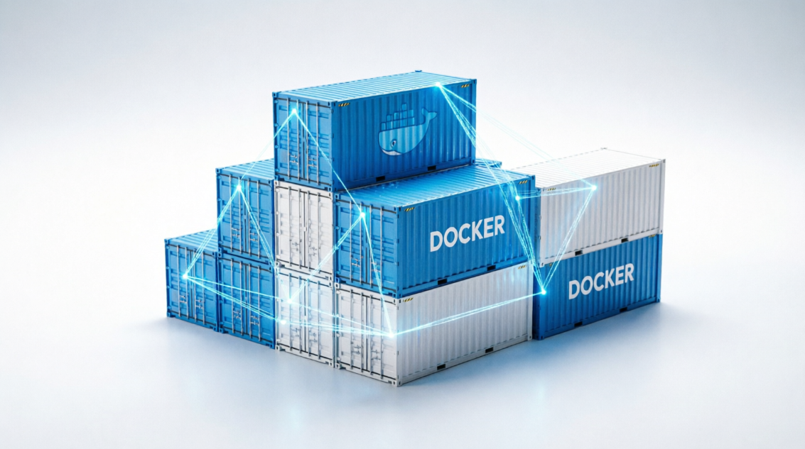
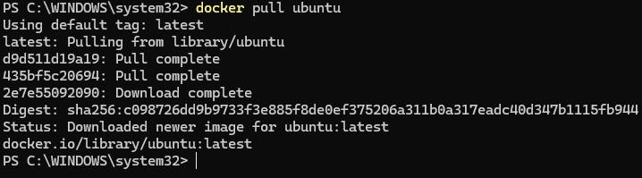
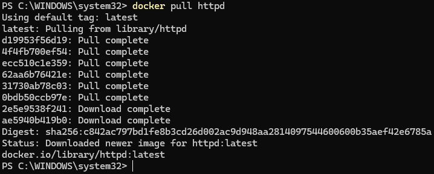
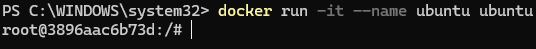
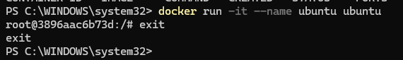
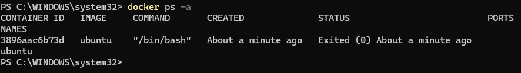

# 2º GSI – Bezmiliana EJECUTANDO Y GESTIONANDO CONTENEDORES

## 19 de octubre del 2026

## Samuel Rivas Fernández

## **Descarga de imagenes**

## Primero instalo las imágenes de ubuntu, debian, mariadb, mysql y httpd

## Y estas son las imágenes descargadas

## **Arranca un contenedor**

## Creo el contenedor y arranco el ubuntu

## Salgo del ubuntu

## Y muestro que me he salido

## Arranco de nuevo el contenedor

## Y en otra terminal muestro los contenedores activos

![][image12]

## Muestro el fichero /etc/os-release sin meterme a la máquina 

![][image13]

## **Ejecutar servicios desde contenedores**

## Arrancar el contenedor de php-apache que se llame web y que sea accesible desde el puerto 8181

## ![][image14]docker  ps compruebo si el contenedor está activo

![][image15]

## Creo el index.html

![][image16]

## Ahora copio el index.html

![][image17]

## Creo el PHP

## ![][image18]

## Y subo el php también

![][image19]

## Y aqui se ve como se puede ver la web desde el navegador

![][image20]

![][image21]

## Ahora instalo la base de datos

![][image22]

![][image23]

## Y la base de datos funciona perfectamente

![][image24]

## **Obtener información de los contenedores**

## Compruebo la IP del contenedor web

![][image25]

## Y compruebo el puerto del contenedor web

![][image26]

## Compruebo la IP de la base de datos

![][image27]

## Y su puerto

![][image28]

